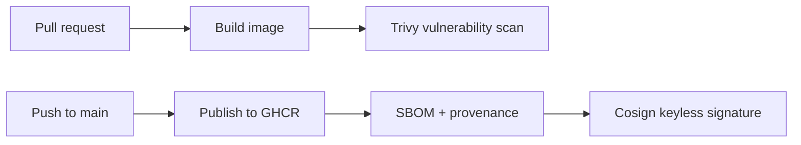

# DevSecOps Software Supply Chain Lab

A small, reviewable example of building and releasing a container with security checks in the delivery workflow. Pull requests build and scan locally; only commits to `main` publish an image to GitHub Container Registry and sign its digest.

## What this demonstrates

- A minimal Python service packaged as a non-root container
- Vulnerability scanning before publishing
- SBOM and BuildKit provenance generation on release builds
- Keyless Cosign signing using GitHub Actions OIDC
- Narrow job permissions and branch-scoped publishing

## Delivery flow



## Run locally

```sh
docker build -t supply-chain-demo:local ./app
docker run --rm -p 8080:8080 supply-chain-demo:local
curl http://localhost:8080/healthz
```

The workflow runs Trivy on pull requests. A finding rated HIGH or CRITICAL fails the scan so the image is not silently promoted. Review findings and update the base image or packages deliberately.

## Published image

On a push to `main`, the workflow publishes:

`ghcr.io/sergiov17/devsecops-supply-chain-lab:<commit-sha>`

The registry package may need to be made public in GitHub Packages settings before anonymous pulls work.

## Verify a release signature

After a successful main-branch release, install Cosign and verify the image by digest:

```sh
cosign verify ghcr.io/sergiov17/devsecops-supply-chain-lab@sha256:<digest> \
  --certificate-identity-regexp='https://github.com/Sergiov17/devsecops-supply-chain-lab/.github/workflows/secure-build.yml@refs/heads/main' \
  --certificate-oidc-issuer=https://token.actions.githubusercontent.com
```

Use the digest emitted by the publish job. Do not verify against a mutable tag.

## Security boundaries

- The pull-request job is read-only and does not receive an OIDC signing token.
- Only the main-branch publish job gets package-write and OIDC permissions.
- The workflow uses GitHub Actions' short-lived token; no long-lived cloud or signing secret is stored.
- This is a learning example. Pin third-party Actions to reviewed commit SHAs before using the pattern in a production organization.

## Repository layout

- `app/main.py`: dependency-free HTTP service with a health endpoint
- `app/Dockerfile`: minimal non-root runtime image
- `.github/workflows/secure-build.yml`: build, scan, publish, attest, sign

## License

MIT. See [LICENSE](LICENSE).
